

### O'qib, qilib va tekshirib o'rganing 🚀

Chuqur maqolalar, interaktiv testlar va suhbatga tayyorgarlik — barchasi **[changeracademy.uz](https://changeracademy.uz)** saytida.

---

# O'zbek tilida dasturlash resurslari

Ushbu repository O'zbek tilida dasturlash bo'yicha turli resurslarni jamlash uchun mo'ljallangan. Bu yerda siz dasturlash tillari, kutubxonalar, frameworklar va boshqa texnologiyalar haqida ma'lumotlar topishingiz mumkin.

## Mavzular

Bu repository Oʻzbek tilida yozilgan:

- Backend
- Node.js
- Database internals
- System design
- Distributed systems
- Networking
- OS

📚 Maqolalar + 🧪 real implementatsiyalar + 📊 benchmarklar

## 🗺️ Yo'l xaritasi (Roadmap)

Til asoslaridan production darajadagi backend va tizim dizaynigacha — to'liq o'quv yo'li. Har bir kartani bosing — maqola ochiladi. <kbd>IXT</kbd> — ixtiyoriy mavzu, <kbd>TEZ ORADA</kbd> — maqola hali yozilmoqda. Jarayoningizni kuzatish uchun: **[changeracademy.uz/roadmap](https://changeracademy.uz/roadmap)**

<a href="https://changeracademy.uz/roadmap"><picture><source media="(prefers-color-scheme: dark)" srcset="assets/roadmap/s01-dark.png"></picture></a>

<picture><source media="(prefers-color-scheme: dark)" srcset="assets/roadmap/s01-g1-dark.png"></picture>

<a href="https://changeracademy.uz/blog/compilerlar-dastur-kodini-qanday-ishlatadi-a562888f-5a6b-46ad-92fb-fb2aa9361eb9"><picture><source media="(prefers-color-scheme: dark)" srcset="assets/roadmap/t001-dark.png">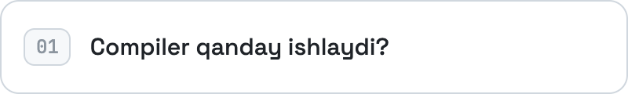</picture></a>
<a href="https://changeracademy.uz/blog/array-va-linked-list-farqlari-d962e219-ea93-4041-af76-4281a8b60ee0"><picture><source media="(prefers-color-scheme: dark)" srcset="assets/roadmap/t002-dark.png">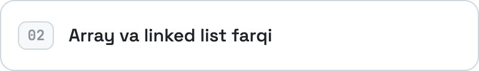</picture></a>
<a href="https://changeracademy.uz/blog/javascriptdagi-iife-haqida-nimalarni-bilamiz-3d7e102a-1c9f-4d30-b5fe-83f7a60be6f6"><picture><source media="(prefers-color-scheme: dark)" srcset="assets/roadmap/t003-dark.png"></picture></a>
<a href="https://changeracademy.uz/blog/javascript-error-handling-xatolar-bilan-ishlash-6ee2f577-116d-437a-b1e4-7cb449acd280"><picture><source media="(prefers-color-scheme: dark)" srcset="assets/roadmap/t004-dark.png"></picture></a>
<a href="https://changeracademy.uz/blog/never-void-any-va-unknown-tiplarining-farqi-nimada-fecb0585-daa0-4e7e-9573-40cf2f9ec59f"><picture><source media="(prefers-color-scheme: dark)" srcset="assets/roadmap/t005-dark.png">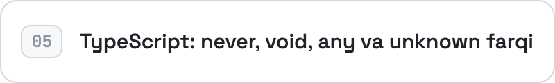</picture></a>
<a href="https://changeracademy.uz/blog/interface-va-type-farqlari-typescript-20a62255-747d-4796-8819-88ccb227489d"><picture><source media="(prefers-color-scheme: dark)" srcset="assets/roadmap/t006-dark.png">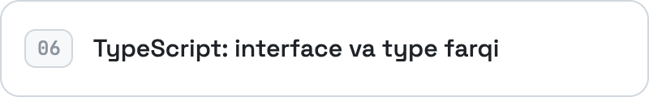</picture></a>

<picture><source media="(prefers-color-scheme: dark)" srcset="assets/roadmap/s01-g2-dark.png"></picture>

<a href="https://changeracademy.uz/blog/terminal-haqida-boshlangich-bilimlar-6c54c1b4-03a0-48d1-be3e-a5fe9ef055f9"><picture><source media="(prefers-color-scheme: dark)" srcset="assets/roadmap/t007-dark.png">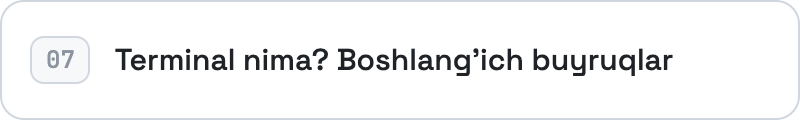</picture></a>
<a href="https://changeracademy.uz/roadmap"><picture><source media="(prefers-color-scheme: dark)" srcset="assets/roadmap/t008-dark.png"></picture></a>
<a href="https://changeracademy.uz/roadmap"><picture><source media="(prefers-color-scheme: dark)" srcset="assets/roadmap/t009-dark.png"></picture></a>
<a href="https://changeracademy.uz/blog/solid-prinsiplari-9e82b17e-676c-40f9-b67a-73af732656a7"><picture><source media="(prefers-color-scheme: dark)" srcset="assets/roadmap/t010-dark.png"></picture></a>
<a href="https://changeracademy.uz/roadmap"><picture><source media="(prefers-color-scheme: dark)" srcset="assets/roadmap/t011-dark.png"></picture></a>

<a href="https://changeracademy.uz/roadmap"><picture><source media="(prefers-color-scheme: dark)" srcset="assets/roadmap/s02-dark.png"></picture></a>

<picture><source media="(prefers-color-scheme: dark)" srcset="assets/roadmap/s02-g1-dark.png"></picture>

<a href="https://changeracademy.uz/blog/unix-qanday-ishlaydi-0528ac24-af36-485b-a3cd-41333a871582"><picture><source media="(prefers-color-scheme: dark)" srcset="assets/roadmap/t012-dark.png">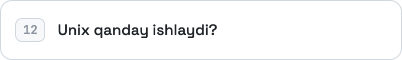</picture></a>
<a href="https://changeracademy.uz/blog/process-va-thread-nima-farqi-bor-c1c38441-cc91-46e8-8b5c-795da89139fd"><picture><source media="(prefers-color-scheme: dark)" srcset="assets/roadmap/t013-dark.png"></picture></a>
<a href="https://changeracademy.uz/blog/thread-pool-nima-7661b95a-cf8c-4bb7-bbaf-06700c1efa36"><picture><source media="(prefers-color-scheme: dark)" srcset="assets/roadmap/t014-dark.png">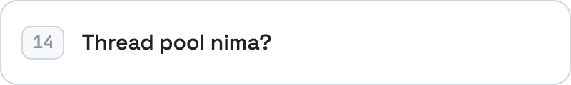</picture></a>
<a href="https://changeracademy.uz/roadmap"><picture><source media="(prefers-color-scheme: dark)" srcset="assets/roadmap/t015-dark.png"></picture></a>

<a href="https://changeracademy.uz/roadmap"><picture><source media="(prefers-color-scheme: dark)" srcset="assets/roadmap/s03-dark.png"></picture></a>

<picture><source media="(prefers-color-scheme: dark)" srcset="assets/roadmap/s03-g1-dark.png"></picture>

<a href="https://changeracademy.uz/blog/nodejs-nimalardan-iborat-va-qanday-qurilgan-af862432-a418-4b99-84fb-224de5a9af1c"><picture><source media="(prefers-color-scheme: dark)" srcset="assets/roadmap/t016-dark.png"></picture></a>
<a href="https://changeracademy.uz/blog/nodejs-single-threadmi-yoki-multi-thread-c1fbc942-63e0-493a-b7b0-d3d1f7e693f8"><picture><source media="(prefers-color-scheme: dark)" srcset="assets/roadmap/t017-dark.png">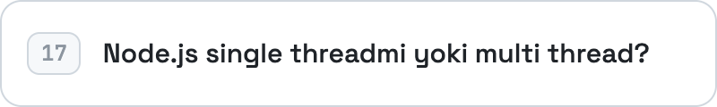</picture></a>
<a href="https://changeracademy.uz/blog/javascriptda-nodejs-modullar-haqida-tanishamiz-cec5be7b-d6ce-4228-9b97-519e22c62f8e"><picture><source media="(prefers-color-scheme: dark)" srcset="assets/roadmap/t018-dark.png"></picture></a>
<a href="https://changeracademy.uz/blog/buffer-haqida-bilib-olamiz-nodejs-94808845-a814-48b4-a530-d56cb841cd52"><picture><source media="(prefers-color-scheme: dark)" srcset="assets/roadmap/t019-dark.png">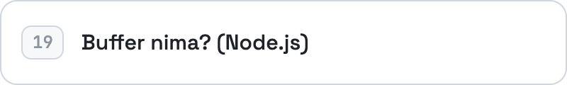</picture></a>
<a href="https://changeracademy.uz/blog/javascriptda-xotira-managmenti-va-garbage-collector-07aa6a6e-310f-4a0a-9e60-8295cc1f8d82"><picture><source media="(prefers-color-scheme: dark)" srcset="assets/roadmap/t020-dark.png"></picture></a>

<picture><source media="(prefers-color-scheme: dark)" srcset="assets/roadmap/s03-g2-dark.png"></picture>

<a href="https://changeracademy.uz/blog/stream-nima-nodejs-ortida-streamlar-qanday-ishlaydi-d7577b32-b94c-41d0-a6e7-e7d62274159f"><picture><source media="(prefers-color-scheme: dark)" srcset="assets/roadmap/t021-dark.png">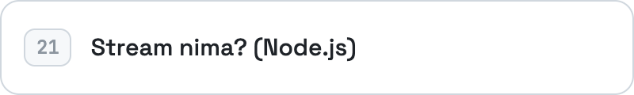</picture></a>
<a href="https://changeracademy.uz/blog/streamni-benchmark-qilamiz-nodejs-4dcb1d5e-e6e3-4e97-9017-3d2d9b4b350c"><picture><source media="(prefers-color-scheme: dark)" srcset="assets/roadmap/t022-dark.png">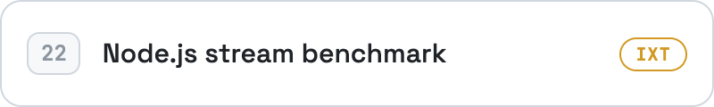</picture></a>
<a href="https://changeracademy.uz/blog/custom-streamlar-yozamiz-nodejs-f1815d9c-fd1e-419b-8326-686add495ba0"><picture><source media="(prefers-color-scheme: dark)" srcset="assets/roadmap/t023-dark.png">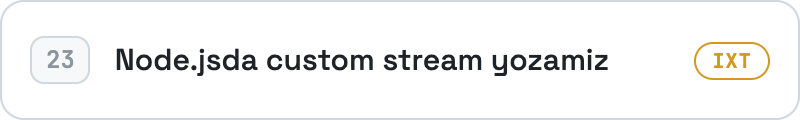</picture></a>
<a href="https://changeracademy.uz/blog/stream-orqali-chat-app-quramiz-0c596b9d-8b79-4a17-b9c0-c802a1df5432"><picture><source media="(prefers-color-scheme: dark)" srcset="assets/roadmap/t024-dark.png">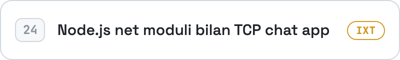</picture></a>
<a href="https://changeracademy.uz/blog/processlar-orasidagi-kommunikatsiya-ipc-cbfeadf8-e9d5-4fb6-b433-798710f9a86c"><picture><source media="(prefers-color-scheme: dark)" srcset="assets/roadmap/t025-dark.png"></picture></a>
<a href="https://changeracademy.uz/blog/nodejsda-child-process-8d251848-8b0a-4a8c-9359-3beb1923678e"><picture><source media="(prefers-color-scheme: dark)" srcset="assets/roadmap/t026-dark.png">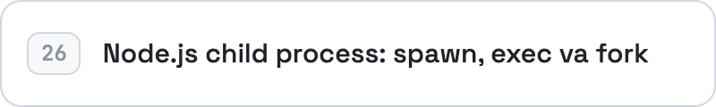</picture></a>
<a href="https://changeracademy.uz/blog/nodejsda-clustering-d4b27d6f-8c44-40e9-a461-8034da49484c"><picture><source media="(prefers-color-scheme: dark)" srcset="assets/roadmap/t027-dark.png">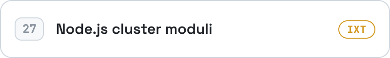</picture></a>
<a href="https://changeracademy.uz/blog/nodejsda-worker-threads-concurrency-va-parallelism-d88a054e-c407-42ef-ae9b-72532d722304"><picture><source media="(prefers-color-scheme: dark)" srcset="assets/roadmap/t028-dark.png">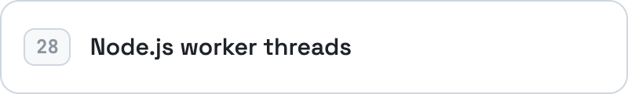</picture></a>
<a href="https://changeracademy.uz/blog/nodejsda-0-dan-threadpool-yozamiz-worker-threads-cff09d97-46da-424d-b6e5-2ae2227c25e9"><picture><source media="(prefers-color-scheme: dark)" srcset="assets/roadmap/t029-dark.png">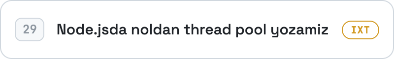</picture></a>

<a href="https://changeracademy.uz/roadmap"><picture><source media="(prefers-color-scheme: dark)" srcset="assets/roadmap/s04-dark.png"></picture></a>

<picture><source media="(prefers-color-scheme: dark)" srcset="assets/roadmap/s04-g1-dark.png"></picture>

<a href="https://changeracademy.uz/blog/internet-qanday-ishlaydi-yoki-malumot-almashish-qanchalik-ozgardi-c520a5d8-4aaa-4f4a-a1c3-f409a0f6f18e"><picture><source media="(prefers-color-scheme: dark)" srcset="assets/roadmap/t030-dark.png"></picture></a>
<a href="https://changeracademy.uz/blog/ip-addresslar-haqida-bilib-olamiz-dd79455d-528d-4ef5-9962-2e4351379476"><picture><source media="(prefers-color-scheme: dark)" srcset="assets/roadmap/t031-dark.png">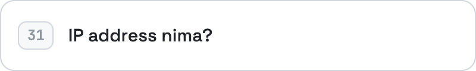</picture></a>
<a href="https://changeracademy.uz/blog/biz-qaysi-ip-addressni-ishlatamiz-nat-7cc12d5d-3d89-44bc-9c0e-3215a16d9bcc"><picture><source media="(prefers-color-scheme: dark)" srcset="assets/roadmap/t032-dark.png">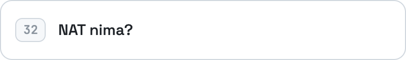</picture></a>
<a href="https://changeracademy.uz/blog/network-yoki-osi-model-qismlari-fb1c8223-7e15-409a-a31b-2f928e4345e1"><picture><source media="(prefers-color-scheme: dark)" srcset="assets/roadmap/t033-dark.png">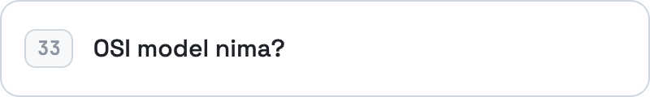</picture></a>
<a href="https://changeracademy.uz/blog/dns-qanday-ishlaydi-7791714c-4404-49cc-99a9-b478ff02fe05"><picture><source media="(prefers-color-scheme: dark)" srcset="assets/roadmap/t034-dark.png">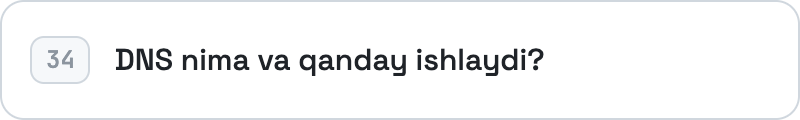</picture></a>

<picture><source media="(prefers-color-scheme: dark)" srcset="assets/roadmap/s04-g2-dark.png"></picture>

<a href="https://changeracademy.uz/blog/tcp-va-udp-aeb180ef-cdbf-44a8-b17d-f3776141dead"><picture><source media="(prefers-color-scheme: dark)" srcset="assets/roadmap/t035-dark.png">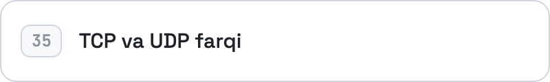</picture></a>
<a href="https://changeracademy.uz/blog/tcp-handshake-034ba299-5b0d-488e-b024-c3829ffaa481"><picture><source media="(prefers-color-scheme: dark)" srcset="assets/roadmap/t036-dark.png">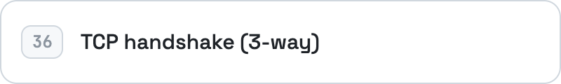</picture></a>
<a href="https://changeracademy.uz/blog/tcp-slow-start-3dc8936f-95a2-49d0-8bcd-a2f2cf9f0c22"><picture><source media="(prefers-color-scheme: dark)" srcset="assets/roadmap/t037-dark.png">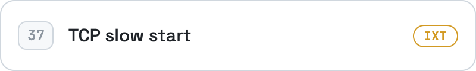</picture></a>
<a href="https://changeracademy.uz/blog/tcp-fast-open-21636a51-b44a-4c6e-b6df-98d380db9dce"><picture><source media="(prefers-color-scheme: dark)" srcset="assets/roadmap/t038-dark.png">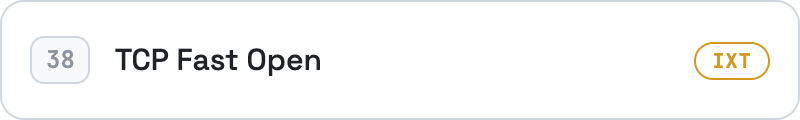</picture></a>
<a href="https://changeracademy.uz/blog/syn-flood-hujumi-haqida-bilasizmi-0c8b6368-8f64-4429-acf1-31e8c4f00c6a"><picture><source media="(prefers-color-scheme: dark)" srcset="assets/roadmap/t039-dark.png">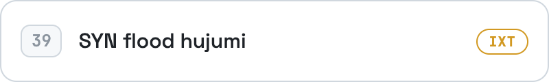</picture></a>
<a href="https://changeracademy.uz/blog/client-va-server-ortasida-aloqa-ornatish-qanday-boladi-os-level-6cac39ef-1314-42e6-a12d-86ec5b0654b3"><picture><source media="(prefers-color-scheme: dark)" srcset="assets/roadmap/t040-dark.png">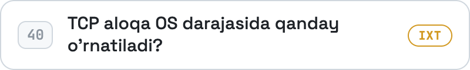</picture></a>
<a href="https://changeracademy.uz/blog/http-http-versiyalari-413838a5-c681-4cf7-9c34-6ffddfbdc24e"><picture><source media="(prefers-color-scheme: dark)" srcset="assets/roadmap/t041-dark.png">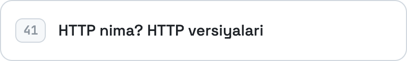</picture></a>
<a href="https://changeracademy.uz/roadmap"><picture><source media="(prefers-color-scheme: dark)" srcset="assets/roadmap/t042-dark.png"></picture></a>

<a href="https://changeracademy.uz/roadmap"><picture><source media="(prefers-color-scheme: dark)" srcset="assets/roadmap/s05-dark.png"></picture></a>

<picture><source media="(prefers-color-scheme: dark)" srcset="assets/roadmap/s05-g1-dark.png"></picture>

<a href="https://changeracademy.uz/roadmap"><picture><source media="(prefers-color-scheme: dark)" srcset="assets/roadmap/t043-dark.png"></picture></a>
<a href="https://changeracademy.uz/roadmap"><picture><source media="(prefers-color-scheme: dark)" srcset="assets/roadmap/t044-dark.png"></picture></a>
<a href="https://changeracademy.uz/blog/databasedagi-keylari-b4e46b21-5c41-417b-9f2c-97be775a8259"><picture><source media="(prefers-color-scheme: dark)" srcset="assets/roadmap/t045-dark.png">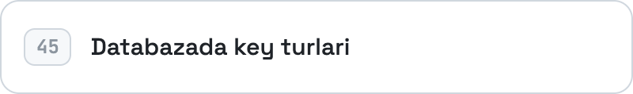</picture></a>
<a href="https://changeracademy.uz/blog/database-normalization-nima-1-qism-bbcc36de-c7d7-4bf7-83ae-3e9202543c93"><picture><source media="(prefers-color-scheme: dark)" srcset="assets/roadmap/t046-dark.png">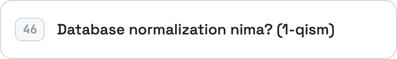</picture></a>
<a href="https://changeracademy.uz/blog/database-normalization-formalari-2-qism-c8c3d603-95db-476c-8168-689a12d85a0c"><picture><source media="(prefers-color-scheme: dark)" srcset="assets/roadmap/t047-dark.png">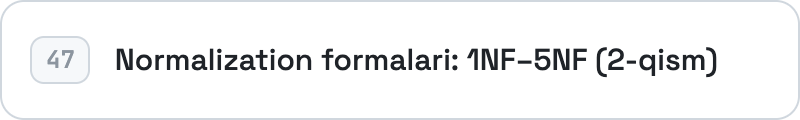</picture></a>
<a href="https://changeracademy.uz/blog/database-denormalization-nimaga-kerak-3-qism-7239c18d-dfb8-4c32-84e9-24f95ee2050c"><picture><source media="(prefers-color-scheme: dark)" srcset="assets/roadmap/t048-dark.png">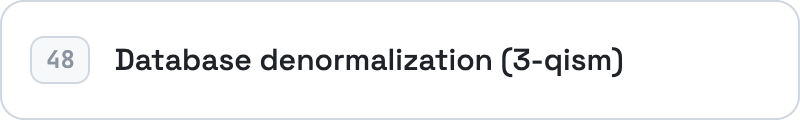</picture></a>

<picture><source media="(prefers-color-scheme: dark)" srcset="assets/roadmap/s05-g2-dark.png"></picture>

<a href="https://changeracademy.uz/blog/databaza-malumotlarni-qanday-saqlaydi-0a878496-9e19-45aa-8c2c-6dcbfa129716"><picture><source media="(prefers-color-scheme: dark)" srcset="assets/roadmap/t049-dark.png"></picture></a>
<a href="https://changeracademy.uz/blog/row-va-columnga-asoslangan-databazalar-526cc594-b249-4b68-b39b-6e6cb518686b"><picture><source media="(prefers-color-scheme: dark)" srcset="assets/roadmap/t050-dark.png"></picture></a>
<a href="https://changeracademy.uz/roadmap"><picture><source media="(prefers-color-scheme: dark)" srcset="assets/roadmap/t051-dark.png"></picture></a>

<a href="https://changeracademy.uz/roadmap"><picture><source media="(prefers-color-scheme: dark)" srcset="assets/roadmap/s06-dark.png"></picture></a>

<picture><source media="(prefers-color-scheme: dark)" srcset="assets/roadmap/s06-g1-dark.png"></picture>

<a href="https://changeracademy.uz/blog/databazadagi-indexlar-haqida-toliq-malumot-a352b4d8-6915-4f8b-987f-174129f42942"><picture><source media="(prefers-color-scheme: dark)" srcset="assets/roadmap/t052-dark.png">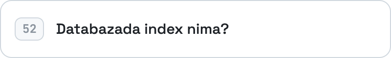</picture></a>
<a href="https://changeracademy.uz/blog/b-tree-bizga-qanday-yordam-beradi-898ada5b-f8d0-4927-9bf2-3e05137605c6"><picture><source media="(prefers-color-scheme: dark)" srcset="assets/roadmap/t053-dark.png">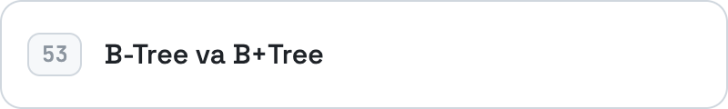</picture></a>
<a href="https://changeracademy.uz/blog/bloom-filters-bdf4eb4c-b1ed-4440-84c2-371701826e02"><picture><source media="(prefers-color-scheme: dark)" srcset="assets/roadmap/t054-dark.png">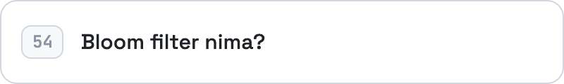</picture></a>

<picture><source media="(prefers-color-scheme: dark)" srcset="assets/roadmap/s06-g2-dark.png"></picture>

<a href="https://changeracademy.uz/blog/bloom-filters-amalda-noldan-kod-yozib-benchmark-qilamiz-5faea6c5-f8c3-4244-b785-c5191c66795f"><picture><source media="(prefers-color-scheme: dark)" srcset="assets/roadmap/t055-dark.png"></picture></a>

<a href="https://changeracademy.uz/roadmap"><picture><source media="(prefers-color-scheme: dark)" srcset="assets/roadmap/s07-dark.png"></picture></a>

<picture><source media="(prefers-color-scheme: dark)" srcset="assets/roadmap/s07-g1-dark.png"></picture>

<a href="https://changeracademy.uz/blog/tranzaksiya-nima-bc559511-ee11-4ae0-8bc7-35a1d6400f14"><picture><source media="(prefers-color-scheme: dark)" srcset="assets/roadmap/t056-dark.png">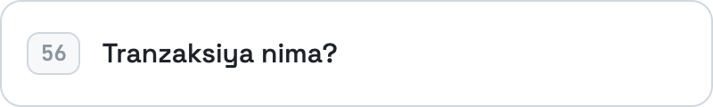</picture></a>
<a href="https://changeracademy.uz/blog/acid-1-qism-atomicity-7bfda916-7134-42ed-bc52-0f032eea4014"><picture><source media="(prefers-color-scheme: dark)" srcset="assets/roadmap/t057-dark.png">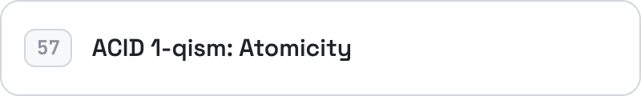</picture></a>
<a href="https://changeracademy.uz/blog/acid-2-qism-isolation-isolation-levels-f59d7686-2885-4d59-bca3-4306505e7859"><picture><source media="(prefers-color-scheme: dark)" srcset="assets/roadmap/t058-dark.png">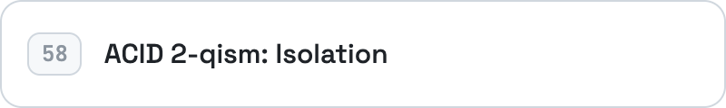</picture></a>
<a href="https://changeracademy.uz/blog/acid-3-qism-consistency-a8406040-7684-40b9-80da-71581897bf6b"><picture><source media="(prefers-color-scheme: dark)" srcset="assets/roadmap/t059-dark.png">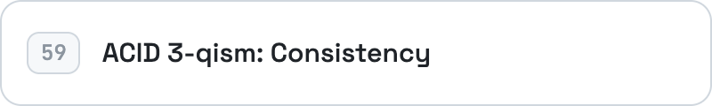</picture></a>
<a href="https://changeracademy.uz/blog/acid-4-qism-durability-37b1928d-84ab-4641-8b8a-d021c345a614"><picture><source media="(prefers-color-scheme: dark)" srcset="assets/roadmap/t060-dark.png"></picture></a>
<a href="https://changeracademy.uz/blog/databazada-concurrency-control-locks-5f1117c2-0674-422c-9acd-7d40cf69ddbf"><picture><source media="(prefers-color-scheme: dark)" srcset="assets/roadmap/t061-dark.png">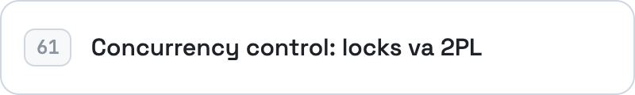</picture></a>

<picture><source media="(prefers-color-scheme: dark)" srcset="assets/roadmap/s07-g2-dark.png"></picture>

<a href="https://changeracademy.uz/blog/acid-misollarda-5-qism-eee7b83c-32ab-4e5a-9e03-0d4485156805"><picture><source media="(prefers-color-scheme: dark)" srcset="assets/roadmap/t062-dark.png">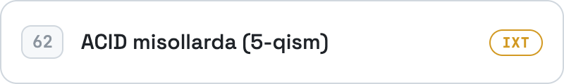</picture></a>
<a href="https://changeracademy.uz/blog/phantom-read-serializable-va-repeatable-isolation-level-farqlari-5a74d866-c263-4097-afcb-b9718748faf4"><picture><source media="(prefers-color-scheme: dark)" srcset="assets/roadmap/t063-dark.png">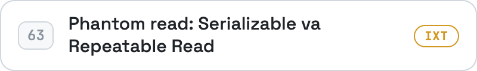</picture></a>

<a href="https://changeracademy.uz/roadmap"><picture><source media="(prefers-color-scheme: dark)" srcset="assets/roadmap/s08-dark.png"></picture></a>

<picture><source media="(prefers-color-scheme: dark)" srcset="assets/roadmap/s08-g1-dark.png"></picture>

<a href="https://changeracademy.uz/blog/database-partitioning-demo-bilan-853628d8-ba53-423f-a04d-64f6cc5fb91b"><picture><source media="(prefers-color-scheme: dark)" srcset="assets/roadmap/t064-dark.png"></picture></a>
<a href="https://changeracademy.uz/blog/database-sharding-fc5fd44c-3a04-40cb-9b46-ac4ced778111"><picture><source media="(prefers-color-scheme: dark)" srcset="assets/roadmap/t065-dark.png"></picture></a>
<a href="https://changeracademy.uz/blog/consistent-hashing-1f3defba-fc63-49c3-ae68-c7cffc85c33f"><picture><source media="(prefers-color-scheme: dark)" srcset="assets/roadmap/t066-dark.png">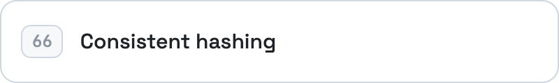</picture></a>
<a href="https://changeracademy.uz/blog/database-replication-0931b2b1-26fb-4abd-8bdf-2cc5179d282c"><picture><source media="(prefers-color-scheme: dark)" srcset="assets/roadmap/t067-dark.png">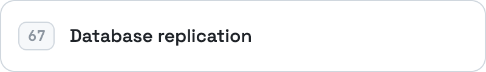</picture></a>
<a href="https://changeracademy.uz/roadmap"><picture><source media="(prefers-color-scheme: dark)" srcset="assets/roadmap/t068-dark.png"></picture></a>

<picture><source media="(prefers-color-scheme: dark)" srcset="assets/roadmap/s08-g2-dark.png"></picture>

<a href="https://changeracademy.uz/blog/consistent-hashing-0-dan-yozamiz-benchmark-bilan-1cb7ae36-68d5-4034-ba5c-3110cc3d3f81"><picture><source media="(prefers-color-scheme: dark)" srcset="assets/roadmap/t069-dark.png">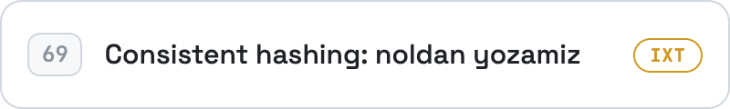</picture></a>
<a href="https://changeracademy.uz/blog/note-app-bilan-sharding-qilamiz-8a312020-380e-42df-bf35-3502211a5cc7"><picture><source media="(prefers-color-scheme: dark)" srcset="assets/roadmap/t070-dark.png">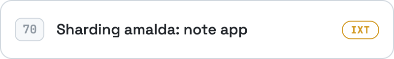</picture></a>
<a href="https://changeracademy.uz/blog/connection-pooling-benchmark-bilan-dd5e8c4e-5573-431d-bafc-b9a3114fd16e"><picture><source media="(prefers-color-scheme: dark)" srcset="assets/roadmap/t071-dark.png">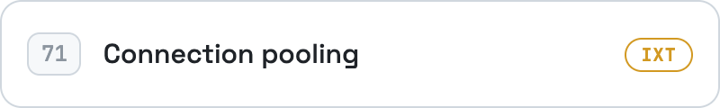</picture></a>

<a href="https://changeracademy.uz/roadmap"><picture><source media="(prefers-color-scheme: dark)" srcset="assets/roadmap/s09-dark.png"></picture></a>

<picture><source media="(prefers-color-scheme: dark)" srcset="assets/roadmap/s09-g1-dark.png"></picture>

<a href="https://changeracademy.uz/roadmap"><picture><source media="(prefers-color-scheme: dark)" srcset="assets/roadmap/t072-dark.png">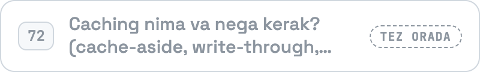</picture></a>
<a href="https://changeracademy.uz/roadmap"><picture><source media="(prefers-color-scheme: dark)" srcset="assets/roadmap/t073-dark.png"></picture></a>
<a href="https://changeracademy.uz/roadmap"><picture><source media="(prefers-color-scheme: dark)" srcset="assets/roadmap/t074-dark.png"></picture></a>

<a href="https://changeracademy.uz/roadmap"><picture><source media="(prefers-color-scheme: dark)" srcset="assets/roadmap/s10-dark.png"></picture></a>

<picture><source media="(prefers-color-scheme: dark)" srcset="assets/roadmap/s10-g1-dark.png"></picture>

<a href="https://changeracademy.uz/blog/distributed-system-nima-7ca8c759-eef1-4a41-844b-2cef2d9b0b4c"><picture><source media="(prefers-color-scheme: dark)" srcset="assets/roadmap/t075-dark.png">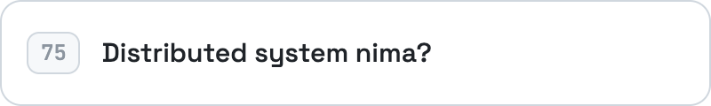</picture></a>
<a href="https://changeracademy.uz/blog/system-design-tushunchalari-real-hayot-bilan-solishtirganda-aaa0f581-f911-40a0-95d1-a4b8a9699163"><picture><source media="(prefers-color-scheme: dark)" srcset="assets/roadmap/t076-dark.png">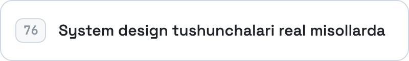</picture></a>
<a href="https://changeracademy.uz/blog/scalability-b7ab6313-e430-4790-acb6-86ea79cb7e08"><picture><source media="(prefers-color-scheme: dark)" srcset="assets/roadmap/t077-dark.png"></picture></a>
<a href="https://changeracademy.uz/roadmap"><picture><source media="(prefers-color-scheme: dark)" srcset="assets/roadmap/t078-dark.png"></picture></a>

<picture><source media="(prefers-color-scheme: dark)" srcset="assets/roadmap/s10-g2-dark.png"></picture>

<a href="https://changeracademy.uz/blog/rate-limiting-nima-977b4f28-ac3f-4a65-aa5e-a0edc041461c"><picture><source media="(prefers-color-scheme: dark)" srcset="assets/roadmap/t079-dark.png"></picture></a>
<a href="https://changeracademy.uz/blog/token-bucket-rate-limiting-algoritmini-0-dan-yozamiz-37b98861-2e6d-4e4b-8488-c35cc34e5a6d"><picture><source media="(prefers-color-scheme: dark)" srcset="assets/roadmap/t080-dark.png"></picture></a>
<a href="https://changeracademy.uz/blog/leaky-bucket-rate-limiting-algoritmini-yozamiz-eb9e2aca-460e-4e7d-9eae-ca6391828fd2"><picture><source media="(prefers-color-scheme: dark)" srcset="assets/roadmap/t081-dark.png"></picture></a>
<a href="https://changeracademy.uz/blog/windowinterval-rate-limiting-algoritmlarini-yozamiz-c6f2c974-10e1-44dc-a07c-649509bce817"><picture><source media="(prefers-color-scheme: dark)" srcset="assets/roadmap/t082-dark.png"></picture></a>

<picture><source media="(prefers-color-scheme: dark)" srcset="assets/roadmap/s10-g3-dark.png"></picture>

<a href="https://changeracademy.uz/blog/cap-theorem-46b44e77-58ec-4f02-8fb6-e89dfcc8627e"><picture><source media="(prefers-color-scheme: dark)" srcset="assets/roadmap/t083-dark.png"></picture></a>
<a href="https://changeracademy.uz/blog/strong-vs-eventual-consistency-988160b2-6b3f-496b-a10a-d045b9c63b00"><picture><source media="(prefers-color-scheme: dark)" srcset="assets/roadmap/t084-dark.png"></picture></a>
<a href="https://changeracademy.uz/blog/single-point-of-failure-spof-10895f34-a779-4c94-b544-2f6ab5a17e4d"><picture><source media="(prefers-color-scheme: dark)" srcset="assets/roadmap/t085-dark.png"></picture></a>
<a href="https://changeracademy.uz/blog/fail-over-va-fault-tolerance-5692c604-d95e-4333-bcaf-65e5c80ccc62"><picture><source media="(prefers-color-scheme: dark)" srcset="assets/roadmap/t086-dark.png"></picture></a>
<a href="https://changeracademy.uz/blog/circuit-breaker-nima-b618d28f-d8b2-41f3-b308-b7813cfe7f73"><picture><source media="(prefers-color-scheme: dark)" srcset="assets/roadmap/t087-dark.png"></picture></a>
<a href="https://changeracademy.uz/roadmap"><picture><source media="(prefers-color-scheme: dark)" srcset="assets/roadmap/t088-dark.png"></picture></a>
<a href="https://changeracademy.uz/roadmap"><picture><source media="(prefers-color-scheme: dark)" srcset="assets/roadmap/t089-dark.png"></picture></a>

<picture><source media="(prefers-color-scheme: dark)" srcset="assets/roadmap/s10-g4-dark.png"></picture>

<a href="https://changeracademy.uz/blog/load-balancer-nima-uchun-kerak-a211aa2a-5cc7-4b4f-97fa-12866eb238ad"><picture><source media="(prefers-color-scheme: dark)" srcset="assets/roadmap/t090-dark.png"></picture></a>
<a href="https://changeracademy.uz/blog/load-balancerlar-bilan-real-amaliyot-27fc8018-eb22-4f9a-a5dc-4b390c95f0ad"><picture><source media="(prefers-color-scheme: dark)" srcset="assets/roadmap/t091-dark.png"></picture></a>
<a href="https://changeracademy.uz/blog/cdn-content-delivery-network-qanday-ishlaydi-84ecd247-e3c6-4b98-a352-47024ed767b1"><picture><source media="(prefers-color-scheme: dark)" srcset="assets/roadmap/t092-dark.png"></picture></a>
<a href="https://changeracademy.uz/blog/forward-va-reverse-proxy-nima-amaliyot-bilan-d8bfc595-d842-4e7c-95a9-b0ac8bf6fee5"><picture><source media="(prefers-color-scheme: dark)" srcset="assets/roadmap/t093-dark.png"></picture></a>

<picture><source media="(prefers-color-scheme: dark)" srcset="assets/roadmap/s10-g5-dark.png"></picture>

<a href="https://changeracademy.uz/blog/backend-kommunikatsiya-usullari-1-qism-55f6cc88-e621-478e-a1f1-276a4c3cb342"><picture><source media="(prefers-color-scheme: dark)" srcset="assets/roadmap/t094-dark.png"></picture></a>
<a href="https://changeracademy.uz/blog/backend-kommunikatsiya-usullari-2-qism-d9fe63c9-00da-4040-85a8-e370476ca72f"><picture><source media="(prefers-color-scheme: dark)" srcset="assets/roadmap/t095-dark.png"></picture></a>
<a href="https://changeracademy.uz/blog/backend-for-frontend-bff-a44773cf-5c06-44f7-8810-06cece114664"><picture><source media="(prefers-color-scheme: dark)" srcset="assets/roadmap/t096-dark.png"></picture></a>
<a href="https://changeracademy.uz/blog/message-queue-nimaga-kerak-e97abef4-9eaa-4c83-bc81-3973b7b3e293"><picture><source media="(prefers-color-scheme: dark)" srcset="assets/roadmap/t097-dark.png"></picture></a>
<a href="https://changeracademy.uz/blog/hodisalarga-asoslangan-arxitektura-event-driven-architecture-5f8e84a6-8f85-4805-9928-0352494f4298"><picture><source media="(prefers-color-scheme: dark)" srcset="assets/roadmap/t098-dark.png"></picture></a>
<a href="https://changeracademy.uz/roadmap"><picture><source media="(prefers-color-scheme: dark)" srcset="assets/roadmap/t099-dark.png"></picture></a>
<a href="https://changeracademy.uz/roadmap"><picture><source media="(prefers-color-scheme: dark)" srcset="assets/roadmap/t100-dark.png"></picture></a>
<a href="https://changeracademy.uz/blog/idempotency-nima-idempotency-key-va-xavfsiz-retry-7e787de6-b128-47ca-a6f8-648ebcf264a7"><picture><source media="(prefers-color-scheme: dark)" srcset="assets/roadmap/t101-dark.png"></picture></a>
<a href="https://changeracademy.uz/roadmap"><picture><source media="(prefers-color-scheme: dark)" srcset="assets/roadmap/t102-dark.png"></picture></a>

<picture><source media="(prefers-color-scheme: dark)" srcset="assets/roadmap/s10-g6-dark.png"></picture>

<a href="https://changeracademy.uz/roadmap"><picture><source media="(prefers-color-scheme: dark)" srcset="assets/roadmap/t103-dark.png"></picture></a>
<a href="https://changeracademy.uz/roadmap"><picture><source media="(prefers-color-scheme: dark)" srcset="assets/roadmap/t104-dark.png"></picture></a>
<a href="https://changeracademy.uz/roadmap"><picture><source media="(prefers-color-scheme: dark)" srcset="assets/roadmap/t105-dark.png"></picture></a>

<a href="https://changeracademy.uz/roadmap"><picture><source media="(prefers-color-scheme: dark)" srcset="assets/roadmap/s11-dark.png"></picture></a>

<picture><source media="(prefers-color-scheme: dark)" srcset="assets/roadmap/s11-g1-dark.png"></picture>

<a href="https://changeracademy.uz/roadmap"><picture><source media="(prefers-color-scheme: dark)" srcset="assets/roadmap/t106-dark.png"></picture></a>
<a href="https://changeracademy.uz/roadmap"><picture><source media="(prefers-color-scheme: dark)" srcset="assets/roadmap/t107-dark.png"></picture></a>
<a href="https://changeracademy.uz/roadmap"><picture><source media="(prefers-color-scheme: dark)" srcset="assets/roadmap/t108-dark.png"></picture></a>
<a href="https://changeracademy.uz/roadmap"><picture><source media="(prefers-color-scheme: dark)" srcset="assets/roadmap/t109-dark.png"></picture></a>
<a href="https://changeracademy.uz/roadmap"><picture><source media="(prefers-color-scheme: dark)" srcset="assets/roadmap/t110-dark.png"></picture></a>

<a href="https://changeracademy.uz/roadmap"><picture><source media="(prefers-color-scheme: dark)" srcset="assets/roadmap/s12-dark.png"></picture></a>

<picture><source media="(prefers-color-scheme: dark)" srcset="assets/roadmap/s12-g1-dark.png"></picture>

<a href="https://changeracademy.uz/roadmap"><picture><source media="(prefers-color-scheme: dark)" srcset="assets/roadmap/t111-dark.png"></picture></a>
<a href="https://changeracademy.uz/roadmap"><picture><source media="(prefers-color-scheme: dark)" srcset="assets/roadmap/t112-dark.png"></picture></a>
<a href="https://changeracademy.uz/roadmap"><picture><source media="(prefers-color-scheme: dark)" srcset="assets/roadmap/t113-dark.png"></picture></a>
<a href="https://changeracademy.uz/roadmap"><picture><source media="(prefers-color-scheme: dark)" srcset="assets/roadmap/t114-dark.png"></picture></a>

<a href="https://changeracademy.uz/roadmap"><picture><source media="(prefers-color-scheme: dark)" srcset="assets/roadmap/s13-dark.png"></picture></a>

<picture><source media="(prefers-color-scheme: dark)" srcset="assets/roadmap/s13-g1-dark.png"></picture>

<a href="https://changeracademy.uz/roadmap"><picture><source media="(prefers-color-scheme: dark)" srcset="assets/roadmap/t115-dark.png"></picture></a>
<a href="https://changeracademy.uz/roadmap"><picture><source media="(prefers-color-scheme: dark)" srcset="assets/roadmap/t116-dark.png"></picture></a>
<a href="https://changeracademy.uz/roadmap"><picture><source media="(prefers-color-scheme: dark)" srcset="assets/roadmap/t117-dark.png"></picture></a>
<a href="https://changeracademy.uz/roadmap"><picture><source media="(prefers-color-scheme: dark)" srcset="assets/roadmap/t118-dark.png"></picture></a>
<a href="https://changeracademy.uz/roadmap"><picture><source media="(prefers-color-scheme: dark)" srcset="assets/roadmap/t119-dark.png"></picture></a>
<a href="https://changeracademy.uz/roadmap"><picture><source media="(prefers-color-scheme: dark)" srcset="assets/roadmap/t120-dark.png"></picture></a>
<a href="https://changeracademy.uz/roadmap"><picture><source media="(prefers-color-scheme: dark)" srcset="assets/roadmap/t121-dark.png"></picture></a>

<a href="https://changeracademy.uz/roadmap"><picture><source media="(prefers-color-scheme: dark)" srcset="assets/roadmap/s14-dark.png"></picture></a>

<picture><source media="(prefers-color-scheme: dark)" srcset="assets/roadmap/s14-g1-dark.png"></picture>

<a href="https://changeracademy.uz/roadmap"><picture><source media="(prefers-color-scheme: dark)" srcset="assets/roadmap/t122-dark.png"></picture></a>
<a href="https://changeracademy.uz/roadmap"><picture><source media="(prefers-color-scheme: dark)" srcset="assets/roadmap/t123-dark.png"></picture></a>

## Resurslar

### ⚙️ System Design

- [System design tushunchalari real hayot bilan solishtirganda](https://changeracademy.uz/blog/system-design-tushunchalari-real-hayot-bilan-solishtirganda-aaa0f581-f911-40a0-95d1-a4b8a9699163)
- [Distributed system nima ?](https://changeracademy.uz/blog/distributed-system-nima-7ca8c759-eef1-4a41-844b-2cef2d9b0b4c)
- [Scalability](https://changeracademy.uz/blog/scalability-b7ab6313-e430-4790-acb6-86ea79cb7e08)
- [CAP theorem](https://changeracademy.uz/blog/cap-theorem-46b44e77-58ec-4f02-8fb6-e89dfcc8627e)
- [Backend for Frontend (BFF)](https://changeracademy.uz/blog/backend-for-frontend-bff-a44773cf-5c06-44f7-8810-06cece114664)
- [Circuit Breaker nima ?](https://changeracademy.uz/blog/circuit-breaker-nima-b618d28f-d8b2-41f3-b308-b7813cfe7f73)
- [Strong vs Eventual consistency](https://changeracademy.uz/blog/strong-vs-eventual-consistency-988160b2-6b3f-496b-a10a-d045b9c63b00)
- [Consistent hashing](https://changeracademy.uz/blog/consistent-hashing-1f3defba-fc63-49c3-ae68-c7cffc85c33f)
- [Consistent hashing 0 dan yozamiz (benchmark bilan)](https://changeracademy.uz/blog/consistent-hashing-0-dan-yozamiz-benchmark-bilan-1cb7ae36-68d5-4034-ba5c-3110cc3d3f81)
- [Note app bilan Sharding qilamiz.](https://changeracademy.uz/blog/note-app-bilan-sharding-qilamiz-8a312020-380e-42df-bf35-3502211a5cc7)
- [Bloom filters](https://changeracademy.uz/blog/bloom-filters-bdf4eb4c-b1ed-4440-84c2-371701826e02)
- [Bloom filters amalda: Noldan kod yozib, benchmark qilamiz](https://changeracademy.uz/blog/bloom-filters-amalda-noldan-kod-yozib-benchmark-qilamiz-5faea6c5-f8c3-4244-b785-c5191c66795f)
- [Rate limiting nima ?](https://changeracademy.uz/blog/rate-limiting-nima-977b4f28-ac3f-4a65-aa5e-a0edc041461c)
- [Token bucket rate limiting algoritmini 0 dan yozamiz !!](https://changeracademy.uz/blog/token-bucket-rate-limiting-algoritmini-0-dan-yozamiz-37b98861-2e6d-4e4b-8488-c35cc34e5a6d)
- [Leaky bucket rate limiting algoritmini yozamiz!](https://changeracademy.uz/blog/leaky-bucket-rate-limiting-algoritmini-yozamiz-eb9e2aca-460e-4e7d-9eae-ca6391828fd2)
- [Window(Interval) rate limiting algoritmlarini yozamiz !](https://changeracademy.uz/blog/windowinterval-rate-limiting-algoritmlarini-yozamiz-c6f2c974-10e1-44dc-a07c-649509bce817)
- [Single point of failure(SPOF)](https://changeracademy.uz/blog/single-point-of-failure-spof-10895f34-a779-4c94-b544-2f6ab5a17e4d)
- [Fail-over va fault tolorence](https://changeracademy.uz/blog/fail-over-va-fault-tolerance-5692c604-d95e-4333-bcaf-65e5c80ccc62)
- [Backend kommunikatsiya usullari (1-qism)](https://changeracademy.uz/blog/backend-kommunikatsiya-usullari-1-qism-55f6cc88-e621-478e-a1f1-276a4c3cb342)
- [Backend kommunikatsiya usullari (2-qism)](https://changeracademy.uz/blog/backend-kommunikatsiya-usullari-2-qism-d9fe63c9-00da-4040-85a8-e370476ca72f)
- [CDN (Content delivery network) qanday ishlaydi ?](https://changeracademy.uz/blog/cdn-content-delivery-network-qanday-ishlaydi-84ecd247-e3c6-4b98-a352-47024ed767b1)
- [Load balancer nima uchun kerak ?](https://changeracademy.uz/blog/load-balancer-nima-uchun-kerak-a211aa2a-5cc7-4b4f-97fa-12866eb238ad)
- [Load balancerlar bilan real amaliyot](https://changeracademy.uz/blog/load-balancerlar-bilan-real-amaliyot-27fc8018-eb22-4f9a-a5dc-4b390c95f0ad)
- [Forward va reverse proxy nima ? (amaliyot bilan)](https://changeracademy.uz/blog/forward-va-reverse-proxy-nima-amaliyot-bilan-d8bfc595-d842-4e7c-95a9-b0ac8bf6fee5)
- [Hodisalarga asoslangan arxitektura (Event driven architecture)](https://changeracademy.uz/blog/hodisalarga-asoslangan-arxitektura-event-driven-architecture-5f8e84a6-8f85-4805-9928-0352494f4298)
- [Message Queue nima va nimaga kerak? Producer, consumer, broker](https://changeracademy.uz/blog/message-queue-nimaga-kerak-e97abef4-9eaa-4c83-bc81-3973b7b3e293)
- [Idempotency nima? Idempotency key va xavfsiz retry](https://changeracademy.uz/blog/idempotency-nima-idempotency-key-va-xavfsiz-retry-7e787de6-b128-47ca-a6f8-648ebcf264a7)

## 🗄️ Databaza bilimlari

- [Database Normalization nima ? (1-qism)](https://changeracademy.uz/blog/database-normalization-nima-1-qism-bbcc36de-c7d7-4bf7-83ae-3e9202543c93)
- [Database Normalization formalari.( 2- qism)](https://changeracademy.uz/blog/database-normalization-formalari-2-qism-c8c3d603-95db-476c-8168-689a12d85a0c)
- [Database Denormalization nimaga kerak ? (3-qism)](https://changeracademy.uz/blog/database-denormalization-nimaga-kerak-3-qism-7239c18d-dfb8-4c32-84e9-24f95ee2050c)
- [Databasedagi hamma keylarni bilasizmi ?](https://changeracademy.uz/blog/databasedagi-keylari-b4e46b21-5c41-417b-9f2c-97be775a8259)
- [Connection pooling(benchmark bilan)](https://changeracademy.uz/blog/connection-pooling-benchmark-bilan-dd5e8c4e-5573-431d-bafc-b9a3114fd16e)
- [Tranzaksiya nima ? (Siz bilmagan malumotlar)](https://changeracademy.uz/blog/tranzaksiya-nima-bc559511-ee11-4ae0-8bc7-35a1d6400f14)
- [ACID 1-qism (Atomicity)](https://changeracademy.uz/blog/acid-1-qism-atomicity-7bfda916-7134-42ed-bc52-0f032eea4014)
- [ACID 2-qism (Isolation, Isolation levels)](https://changeracademy.uz/blog/acid-2-qism-isolation-isolation-levels-f59d7686-2885-4d59-bca3-4306505e7859)
- [ACID 3-qism (Consistency)](https://changeracademy.uz/blog/acid-3-qism-consistency-a8406040-7684-40b9-80da-71581897bf6b)
- [ACID 4-qism (Durability)](https://changeracademy.uz/blog/acid-4-qism-durability-37b1928d-84ab-4641-8b8a-d021c345a614)
- [ACID misollarda 5-qism](https://changeracademy.uz/blog/acid-misollarda-5-qism-eee7b83c-32ab-4e5a-9e03-0d4485156805)
- [Databazada concurrency control (locks)](https://changeracademy.uz/blog/databazada-concurrency-control-locks-5f1117c2-0674-422c-9acd-7d40cf69ddbf)
- [Phantom read,Serializable va Repeatable isolation level farqlari](https://changeracademy.uz/blog/phantom-read-serializable-va-repeatable-isolation-level-farqlari-5a74d866-c263-4097-afcb-b9718748faf4)
- [B-Tree bizga qanday yordam beradi](https://changeracademy.uz/blog/b-tree-bizga-qanday-yordam-beradi-898ada5b-f8d0-4927-9bf2-3e05137605c6)
- [Databazadagi indexlar haqida to`liq malumot.](https://changeracademy.uz/blog/databazadagi-indexlar-haqida-toliq-malumot-a352b4d8-6915-4f8b-987f-174129f42942)
- [Row va columnga asoslangan databazalar](https://changeracademy.uz/blog/row-va-columnga-asoslangan-databazalar-526cc594-b249-4b68-b39b-6e6cb518686b)
- [Databaza malumotlarni qanday saqlaydi ?](https://changeracademy.uz/blog/databaza-malumotlarni-qanday-saqlaydi-0a878496-9e19-45aa-8c2c-6dcbfa129716)
- [Database sharding](https://changeracademy.uz/blog/database-sharding-fc5fd44c-3a04-40cb-9b46-ac4ced778111)
- [Database Partitioning (demo bilan)](https://changeracademy.uz/blog/database-partitioning-demo-bilan-853628d8-ba53-423f-a04d-64f6cc5fb91b)
- [Database Replication](https://changeracademy.uz/blog/database-replication-0931b2b1-26fb-4abd-8bdf-2cc5179d282c)

## 🌐 Tarmoq(Networking) bilimlari

- [IP addresslar haqida bilib olamiz .](https://changeracademy.uz/blog/ip-addresslar-haqida-bilib-olamiz-dd79455d-528d-4ef5-9962-2e4351379476)
- [Internet qanday ishlaydi yoki malumot almashish qanchalik o`zgardi ?](https://changeracademy.uz/blog/internet-qanday-ishlaydi-yoki-malumot-almashish-qanchalik-ozgardi-c520a5d8-4aaa-4f4a-a1c3-f409a0f6f18e)
- [Network yoki OSI model qismlari .](https://changeracademy.uz/blog/network-yoki-osi-model-qismlari-fb1c8223-7e15-409a-a31b-2f928e4345e1)
- [TCP handshake](https://changeracademy.uz/blog/tcp-handshake-034ba299-5b0d-488e-b024-c3829ffaa481)
- [TCP slow start](https://changeracademy.uz/blog/tcp-slow-start-3dc8936f-95a2-49d0-8bcd-a2f2cf9f0c22)
- [TCP fast open](https://changeracademy.uz/blog/tcp-fast-open-21636a51-b44a-4c6e-b6df-98d380db9dce)
- [TCP va UDP](https://changeracademy.uz/blog/tcp-va-udp-aeb180ef-cdbf-44a8-b17d-f3776141dead)
- [HTTP (HTTP versiyalari)](https://changeracademy.uz/blog/http-http-versiyalari-413838a5-c681-4cf7-9c34-6ffddfbdc24e)
- [Biz qaysi IP addressni ishlatamiz ? (NAT)](https://changeracademy.uz/blog/biz-qaysi-ip-addressni-ishlatamiz-nat-7cc12d5d-3d89-44bc-9c0e-3215a16d9bcc)
- [SYN Flood hujumi haqida bilasizmi ?](https://changeracademy.uz/blog/syn-flood-hujumi-haqida-bilasizmi-0c8b6368-8f64-4429-acf1-31e8c4f00c6a)
- [DNS qanday ishlaydi ?](https://changeracademy.uz/blog/dns-qanday-ishlaydi-7791714c-4404-49cc-99a9-b478ff02fe05)

## 🖥️ Operatsion Sistema

- [Unix qanday ishlaydi ?](https://changeracademy.uz/blog/unix-qanday-ishlaydi-0528ac24-af36-485b-a3cd-41333a871582)
- [Terminal haqida boshlang`ich bilimlar ?](https://changeracademy.uz/blog/terminal-haqida-boshlangich-bilimlar-6c54c1b4-03a0-48d1-be3e-a5fe9ef055f9)
- [Processlar orasidagi kommunikatsiya(IPC)](https://changeracademy.uz/blog/processlar-orasidagi-kommunikatsiya-ipc-cbfeadf8-e9d5-4fb6-b433-798710f9a86c)
- [Process va thread nima farqi bor ?](https://changeracademy.uz/blog/process-va-thread-nima-farqi-bor-c1c38441-cc91-46e8-8b5c-795da89139fd)
- [Client va server o`rtasida aloqa o`rnatish qanday bo`ladi ? (OS level)](https://changeracademy.uz/blog/client-va-server-ortasida-aloqa-ornatish-qanday-boladi-os-level-6cac39ef-1314-42e6-a12d-86ec5b0654b3)

## Node.js

- [Nodejs nimalardan iborat va qanday qurilgan ?](https://changeracademy.uz/blog/nodejs-nimalardan-iborat-va-qanday-qurilgan-af862432-a418-4b99-84fb-224de5a9af1c)
- [Stream nima? Nodejs ortida streamlar qanday ishlaydi ?](https://changeracademy.uz/blog/stream-nima-nodejs-ortida-streamlar-qanday-ishlaydi-d7577b32-b94c-41d0-a6e7-e7d62274159f)
- [Custom streamlar yozamiz (Nodejs).](https://changeracademy.uz/blog/custom-streamlar-yozamiz-nodejs-f1815d9c-fd1e-419b-8326-686add495ba0)
- [Streamni benchmark qilamiz (nodejs).](https://changeracademy.uz/blog/streamni-benchmark-qilamiz-nodejs-4dcb1d5e-e6e3-4e97-9017-3d2d9b4b350c)
- [Stream orqali chat app quramiz.](https://changeracademy.uz/blog/stream-orqali-chat-app-quramiz-0c596b9d-8b79-4a17-b9c0-c802a1df5432)
- [Buffer haqida bilib olamiz (Nodejs).](https://changeracademy.uz/blog/buffer-haqida-bilib-olamiz-nodejs-94808845-a814-48b4-a530-d56cb841cd52)
- [Nodejs single threadmi yoki multi thread ?](https://changeracademy.uz/blog/nodejs-single-threadmi-yoki-multi-thread-c1fbc942-63e0-493a-b7b0-d3d1f7e693f8)
- [Nodejsda Worker threads(Concurrency va Parallelism)](https://changeracademy.uz/blog/nodejsda-worker-threads-concurrency-va-parallelism-d88a054e-c407-42ef-ae9b-72532d722304)
- [Nodejsda Clustering](https://changeracademy.uz/blog/nodejsda-clustering-d4b27d6f-8c44-40e9-a461-8034da49484c)
- [Nodejsda Child process](https://changeracademy.uz/blog/nodejsda-child-process-8d251848-8b0a-4a8c-9359-3beb1923678e)
- [Thread pool nima ?](https://changeracademy.uz/blog/thread-pool-nima-7661b95a-cf8c-4bb7-bbaf-06700c1efa36)
- [Nodejsda 0 dan threadpool yozamiz(worker threads)](https://changeracademy.uz/blog/nodejsda-0-dan-threadpool-yozamiz-worker-threads-cff09d97-46da-424d-b6e5-2ae2227c25e9)

## JavaScript & TypeScript

- [JavaScriptda xotira managmenti va garbage collector.](https://changeracademy.uz/blog/javascriptda-xotira-managmenti-va-garbage-collector-07aa6a6e-310f-4a0a-9e60-8295cc1f8d82)
- [Javascript Error handling (Xatolar bilan ishlash)](https://changeracademy.uz/blog/javascript-error-handling-xatolar-bilan-ishlash-6ee2f577-116d-437a-b1e4-7cb449acd280)
- [Javascriptdagi IIFE haqida nimalarni bilamiz ?](https://changeracademy.uz/blog/javascriptdagi-iife-haqida-nimalarni-bilamiz-3d7e102a-1c9f-4d30-b5fe-83f7a60be6f6)
- [Javascriptda (Nodejs) modullar haqida tanishamiz.](https://changeracademy.uz/blog/javascriptda-nodejs-modullar-haqida-tanishamiz-cec5be7b-d6ce-4228-9b97-519e22c62f8e)
- [Never, void ,any va unknown tiplarining farqi nimada ?](https://changeracademy.uz/blog/never-void-any-va-unknown-tiplarining-farqi-nimada-fecb0585-daa0-4e7e-9573-40cf2f9ec59f)
- [Interface va type farqlari (Typescript)](https://changeracademy.uz/blog/interface-va-type-farqlari-typescript-20a62255-747d-4796-8819-88ccb227489d)

## 📌 Qo'shimcha foydali mavzular

- [SOLID prinsiplari](https://changeracademy.uz/blog/solid-prinsiplari-9e82b17e-676c-40f9-b67a-73af732656a7)
- [Array va Linked list farqlari](https://changeracademy.uz/blog/array-va-linked-list-farqlari-d962e219-ea93-4041-af76-4281a8b60ee0)
- [Compilerlar dastur kodini qanday ishlatadi ?](https://changeracademy.uz/blog/compilerlar-dastur-kodini-qanday-ishlatadi-a562888f-5a6b-46ad-92fb-fb2aa9361eb9)

> 💡 Barcha maqolalar **[changeracademy.uz](https://changeracademy.uz)** saytida chop etiladi.
> Yangi maqolalar birinchi bo'lib o'sha yerda chiqadi — [barcha maqolalar](https://changeracademy.uz/articles).

---

## 🧪 Amaliyot (Kod namunalari)

Real implementatsiyalar — maqolalardagi nazariyani amalda ko'ring:

### ⚙️ System Design

| Papka                                                      | Mavzu                                       | Maqola                                                                                                                                                                                              |
| ---------------------------------------------------------- | ------------------------------------------- | --------------------------------------------------------------------------------------------------------------------------------------------------------------------------------------------------- |
| [backend-communication-ways/](backend-communication-ways/) | Short/Long Polling, WebSocket, SSE, Pub/Sub | [1-qism](https://changeracademy.uz/blog/backend-kommunikatsiya-usullari-1-qism-55f6cc88-e621-478e-a1f1-276a4c3cb342) · [2-qism](https://changeracademy.uz/blog/backend-kommunikatsiya-usullari-2-qism-d9fe63c9-00da-4040-85a8-e370476ca72f) |
| [bloom-filters/](bloom-filters/)                           | Bloom Filter + benchmark                    | [Nazariya](https://changeracademy.uz/blog/bloom-filters-bdf4eb4c-b1ed-4440-84c2-371701826e02) · [Amaliyot](https://changeracademy.uz/blog/bloom-filters-amalda-noldan-kod-yozib-benchmark-qilamiz-5faea6c5-f8c3-4244-b785-c5191c66795f)       |
| [consistent-hashing/](consistent-hashing/)                 | Consistent Hashing + virtual nodes          | [Nazariya](https://changeracademy.uz/blog/consistent-hashing-1f3defba-fc63-49c3-ae68-c7cffc85c33f) · [Amaliyot](https://changeracademy.uz/blog/consistent-hashing-0-dan-yozamiz-benchmark-bilan-1cb7ae36-68d5-4034-ba5c-3110cc3d3f81)         |
| [load-balancer/](load-balancer/)                           | HAProxy Layer 4/7, Least Connection         | [Maqola](https://changeracademy.uz/blog/load-balancer-nima-uchun-kerak-a211aa2a-5cc7-4b4f-97fa-12866eb238ad)                                                                                                            |

### 🗄️ Databaza

| Papka                                                        | Mavzu                                      | Maqola                                                                                                                                                                    |
| ------------------------------------------------------------ | ------------------------------------------ | ------------------------------------------------------------------------------------------------------------------------------------------------------------------------- |
| [database-connection-pooling/](database-connection-pooling/) | Connection Pool + benchmark                | [Maqola](https://changeracademy.uz/blog/connection-pooling-benchmark-bilan-dd5e8c4e-5573-431d-bafc-b9a3114fd16e)                                                                               |
| [database-partitioning/](database-partitioning/)             | RANGE partitioning + 10M qator             | [Maqola](https://changeracademy.uz/blog/database-partitioning-demo-bilan-853628d8-ba53-423f-a04d-64f6cc5fb91b)                                                                                 |
| [database-replication/](database-replication/)               | Replication (nazariy)                      | [Maqola](https://changeracademy.uz/blog/database-replication-0931b2b1-26fb-4abd-8bdf-2cc5179d282c)                                                                                             |
| [database-sharding/](database-sharding/)                     | Sharding + Consistent Hashing + migratsiya | [Sharding](https://changeracademy.uz/blog/database-sharding-fc5fd44c-3a04-40cb-9b46-ac4ced778111) · [Amaliyot](https://changeracademy.uz/blog/note-app-bilan-sharding-qilamiz-8a312020-380e-42df-bf35-3502211a5cc7) |

### 🌐 Tarmoq (Networking)

| Papka                | Mavzu                            | Maqola                                                                                                                                               |
| -------------------- | -------------------------------- | ---------------------------------------------------------------------------------------------------------------------------------------------------- |
| [network/](network/) | TCP, UDP, Chat App, Fayl yuklash | [TCP va UDP](https://changeracademy.uz/blog/tcp-va-udp-aeb180ef-cdbf-44a8-b17d-f3776141dead) · [DNS](https://changeracademy.uz/blog/dns-qanday-ishlaydi-7791714c-4404-49cc-99a9-b478ff02fe05) |

### 🖥️ Node.js

| Papka                              | Mavzu                                              | Maqola                                                                                                                                                                                                               |
| ---------------------------------- | -------------------------------------------------- | -------------------------------------------------------------------------------------------------------------------------------------------------------------------------------------------------------------------- |
| [stream/](stream/)                 | Custom Readable/Writable/Duplex stream + benchmark | [Stream nima?](https://changeracademy.uz/blog/stream-nima-nodejs-ortida-streamlar-qanday-ishlaydi-d7577b32-b94c-41d0-a6e7-e7d62274159f) · [Benchmark](https://changeracademy.uz/blog/streamni-benchmark-qilamiz-nodejs-4dcb1d5e-e6e3-4e97-9017-3d2d9b4b350c) |
| [worker-threads/](worker-threads/) | MessagePort, MessageChannel, workerData            | [Maqola](https://changeracademy.uz/blog/nodejsda-worker-threads-concurrency-va-parallelism-d88a054e-c407-42ef-ae9b-72532d722304)                                                                                                          |
| [threadpool/](threadpool/)         | ThreadPool klassi + benchmark                      | [Maqola](https://changeracademy.uz/blog/thread-pool-nima-7661b95a-cf8c-4bb7-bbaf-06700c1efa36)                                                                                                                            |
| [clustering/](clustering/)         | Cluster + benchmark + IPC                          | [Maqola](https://changeracademy.uz/blog/nodejsda-clustering-d4b27d6f-8c44-40e9-a461-8034da49484c)                                                                                                                         |
| [child-process/](child-process/)   | exec, spawn, fork misollari                        | [Maqola](https://changeracademy.uz/blog/nodejsda-child-process-8d251848-8b0a-4a8c-9359-3beb1923678e)                                                                                                                      |
| [events-module/](events-module/)   | EventEmitter noldan implementatsiya                | [Maqola](https://changeracademy.uz/blog/nodejs-nimalardan-iborat-va-qanday-qurilgan-af862432-a418-4b99-84fb-224de5a9af1c)                                                                                                                 |

### 🖧 Operatsion Sistema

| Papka                                            | Mavzu                            | Maqola                                                                                        |
| ------------------------------------------------ | -------------------------------- | --------------------------------------------------------------------------------------------- |
| [process-communication/](process-communication/) | Stdin/Stdout, Unix Domain Socket | [IPC](https://changeracademy.uz/blog/processlar-orasidagi-kommunikatsiya-ipc-cbfeadf8-e9d5-4fb6-b433-798710f9a86c) |
| [file-commander/](file-commander/)               | fs moduli, fayl operatsiyalari   | [Unix](https://changeracademy.uz/blog/unix-qanday-ishlaydi-0528ac24-af36-485b-a3cd-41333a871582)                   |

---

## 🤝 Hissa qoʻshish

PR ochishingiz mumkin:

- xatolarni tuzatish
- yangi implementatsiyalar
- testlar

Ko'proq ma'lumot olish uchun [CONTRIBUTING.md](CONTRIBUTING.md) faylini o'qing.

---

 <i>Agar repo foydali bo‘lsa ⭐ yulduzcha bosing — bu loyiha rivojlanishiga katta yordam beradi.</i>
  
  
 Ko'proq maqola, test va suhbatga tayyorgarlik uchun 👉 <a href="https://changeracademy.uz"><b>changeracademy.uz</b></a>

